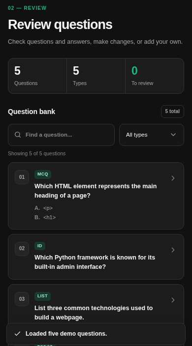

<div align="center">
  

  # QuestionForge

  **Good questions deserve a well-made paper.**

  A free, local-first Chrome extension for preparing curriculum-based assessments, reviewing questions, and exporting polished Word and PDF papers.

  [Product overview](index.html) · [Getting started](guide.html) · [FAQ](faq.html) · [Privacy policy](privacy.html) · [Contact & support](contact.html)
</div>

---

## About the project

**QuestionForge** helps teachers turn AI-generated questions into usable assessments without handing over control of the process. Prepare a coverage plan from a lesson plan, Budget of Work (BOW), Table of Specifications (TOS), or curriculum guide; check the generated questions and answers; then format the finished paper for students or teachers.

QuestionForge **does not generate questions using its own AI model**. It creates structured prompts for use with ChatGPT, and you choose what source material to copy into that conversation.

**Current status:** developer preview. This repository contains the **public information website** and its **minified production extension download**. It is **not** the editable extension development repository or a Chrome Web Store listing.

## A look at QuestionForge

| Review questions | Format an assessment |
| :---: | :---: |
|  |  |

*Screenshots demonstrate the interface and an example paper, not a live interactive demo.*

## What it can do

- **Work from teaching materials.** Import supported DOCX, XLSX, TXT, CSV, and text-based PDF documents; review extracted text and structured tables before approval.
- **Plan before generating.** Create a coverage-planning prompt, review the proposed allocation, and then prepare the exam-generation prompt.
- **Import structured questions.** Prefer JSON for dependable question numbering, types, options, answers, and explanations.
- **Review and correct.** Edit question content, answer choices, points, question types, and answer keys before exporting.
- **Format for the classroom.** Add school details and a logo; choose fonts, paper size, margins, headers, footers, and one- or two-column question layouts.
- **Export documents.** Generate editable Word (`.docx`) documents or use Chrome's Print → Save as PDF.
- **Keep control of your data.** Processing is local to the extension; draft saving is optional. Sending source content to ChatGPT requires an explicit copy-and-paste action.

### Supported assessment types

Multiple choice · Identification · Enumeration · Essay · True or False

### Important limitations

- Scanned PDFs **do not have automatic OCR** in the current release. Complex PDF layouts and tables may extract incorrectly.
- Source extraction and AI-generated questions **must be checked by a teacher**; neither is guaranteed to be accurate.
- Long teaching documents can exceed external AI context limits, even when split into numbered source packets.
- Saved drafts are **not encrypted by QuestionForge**. Use its no-save setting for sensitive materials.
- QuestionForge does not process GCash payments or verify whether a donation was made.

## How the workflow works

1. **Prepare** — Import or paste relevant teaching material and verify the extracted content.
2. **Plan** — Copy the coverage-planning prompt into ChatGPT and check its proposed question allocation.
3. **Generate** — After approving the plan, request questions in QuestionForge-compatible structured JSON.
4. **Review** — Import the JSON, inspect question counts and answer keys, and make corrections.
5. **Export** — Select your document layout and generate a Word file or print to PDF.

See the [step-by-step user guide](guide.html) for the full process and troubleshooting instructions.

## Install the Chrome extension

QuestionForge is currently provided as a **developer-preview production package**, not an official Chrome Web Store installation.

1. Download [`QuestionForge-v0.8.4-production.zip`](downloads/QuestionForge-v0.8.4-production.zip).
2. Extract it locally.
3. Open `chrome://extensions` in Chrome.
4. Turn on **Developer mode** and choose **Load unpacked**.
5. Select the extracted extension folder containing `manifest.json`.
6. Open QuestionForge from the browser toolbar or side panel.

For the published archive's SHA-256 fingerprint and installation notes, see [Getting started](guide.html#install). Only install unpacked extensions from sources you trust.

## Website technology

This website is intentionally simple:

| Layer | Technology |
| --- | --- |
| Markup | HTML5 |
| Styling | CSS3 with responsive light and dark themes |
| Interactions | Vanilla JavaScript |
| Hosting | Static hosting, including Vercel |
| Runtime services | No application server, database, or account system |

There is **no npm install or build step** for the website, and no third-party analytics SDK, advertising SDK, or remote font dependency. The site does remember your light/dark theme preference in browser local storage. The hosting provider may maintain its own technical access logs.

### Repository structure

```text
questionforge-website/
├── index.html                # Product landing page
├── guide.html                # Installation and user guide
├── faq.html                  # Frequently asked questions
├── privacy.html              # Public privacy policy
├── contact.html              # Support and GCash donations
├── 404.html                  # Not-found page
├── assets/                   # QF branding, screenshots, CSS, JS, GCash images
│   ├── site.css
│   ├── theme.css
│   ├── theme-init.js
│   ├── site.js
│   └── ...
├── downloads/
│   └── QuestionForge-v0.8.4-production.zip
└── README.md
```

## Develop and preview the website locally

You only need a browser and a small local HTTP server. For example, with Python:

```bash
cd questionforge-website
python -m http.server 8000
```

Then visit **http://localhost:8000**.

Changes to HTML, CSS, or JavaScript are available after refreshing the page. The extension production ZIP is a separate, already-built download; editing the website does not rebuild the extension.

## Deploy to Vercel

**Recommended:** connect a Git repository containing **only this website and the production extension ZIP**. Keep the editable extension source, test suites, private release tooling, secrets, and configuration utilities out of this repository.

1. Go to [Vercel](https://vercel.com/new) and import the website repository.
2. Set the **Root Directory** to the folder containing `index.html` (or leave it as the repository root if the website files are at the top level).
3. Choose **Framework Preset: Other**.
4. **Skip the build step** — no build command or output-generation script is needed. Serve the website from its root folder.
5. Deploy, then open the assigned HTTPS URL and check the pages and download.

> The production website URL is not yet specified here. Do not add a guessed domain or a placeholder privacy-policy URL to the extension.

### After deployment

Verify each live address in your browser:

```text
https://YOUR-REAL-DOMAIN/privacy.html
https://YOUR-REAL-DOMAIN/contact.html
https://YOUR-REAL-DOMAIN/guide.html
```

Next, configure the **production extension's official-site URL** using the private release tool described in [`LEGAL_LINKS_SETUP.md`](LEGAL_LINKS_SETUP.md). Repackage the production extension, update the website download and SHA-256 value, then redeploy both together.

### Release checklist

- [ ] Confirm that `privacy.html`, `contact.html`, `guide.html`, and the ZIP download load publicly over HTTPS.
- [ ] Verify the source package is the **production build**, not editable development code or test files.
- [ ] Recalculate the download's SHA-256 after every release and update its displayed checksum.
- [ ] Check that the About → Privacy and Contact links open the **real published site**.
- [ ] Review the privacy policy after changing storage, permissions, uploads, or donation behavior.
- [ ] Test desktop and mobile layouts in both themes, plus keyboard navigation.
- [ ] Test the extension in a clean Chrome profile before sharing broadly.
- [ ] Confirm the GCash QR shows the intended receiving account and disclose any recipient details visible to visitors.

See [`PUBLISH_CHECKLIST.md`](PUBLISH_CHECKLIST.md) for the broader launch checklist.

## Privacy and responsible use

QuestionForge's document extraction happens in the browser. It does **not automatically upload teaching materials** to ChatGPT or to the QuestionForge website. If you copy and paste extracted text into a third-party AI service, that content is then subject to that service's terms and privacy practices.

Question drafts may be stored in local Chrome extension storage when saving is enabled. They are not encrypted by QuestionForge. Disable saving or clear stored data when working with sensitive assessments, and remove student information from anything you share externally.

The website is static and has no account-registration or payment-processing system. Optional **GCash** support displays a public receiving QR; payments take place outside QuestionForge. Donations never unlock features. Visitors should confirm the recipient in GCash before transferring funds.

Read the full [Privacy Policy](privacy.html) before distributing the extension to a school or institution.

## Support and project links

- **Help and feedback:** [Contact & Support](contact.html)
- **Developer profile:** [GitHub — xf00889](https://github.com/xf00889)
- **Optional GCash support:** [Donate via GCash](contact.html#support-the-project)

When reporting a problem, include the QuestionForge and Chrome versions, steps to reproduce, and a screenshot **with private student or examination details removed**.

## Source availability and rights

This repository contains a publicly served website and an installable **bundled/minified extension release**. The editable extension source and its build tooling are maintained separately and are **not published here**. Minification reduces readability but cannot make client-side extension code secret.

No open-source license for the QuestionForge extension is granted by this repository. Please contact the developer before copying, modifying, or redistributing its code or brand assets.

QuestionForge is an independent project and is **not affiliated with OpenAI, Google, or GCash**.

---

<div align="center">
  <sub>© 2026 QuestionForge · Built to help teachers create better-organized assessments.</sub>
</div>


## Mobile experience update (v1.7)

The site now has improved mobile navigation, a swipeable product preview, tap-friendly buttons, compact help-page navigation, and responsive GCash support. See [MOBILE_UPDATE.md](MOBILE_UPDATE.md). No framework or build command is required.
